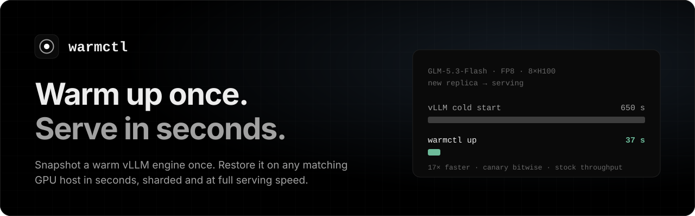
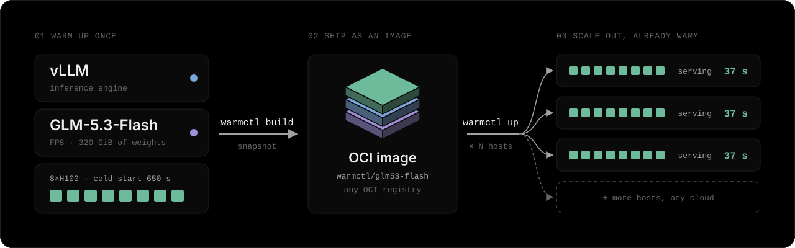

<p align="center">
  <a href="https://warmctl.io"></a>
</p>

<p align="center">
  <a href="https://github.com/TensorRails/warmctl/releases"></a>
  <a href="https://github.com/TensorRails/warmctl/actions/workflows/ci.yml"></a>
  <a href="LICENSE"></a>
  
  
</p>

warmctl snapshots a warmed-up vLLM engine and restores it in seconds on any
host with the same GPUs and NVIDIA driver branch. GLM-5.3-Flash on 8×H100:
vLLM cold start 650 s, `warmctl up` 37 s, then stock serving speed.

<p align="center">
  
</p>

## Quickstart

Linux GPU host, Docker with the NVIDIA runtime, root:

```bash
curl -fsSL https://warmctl.io/install.sh | sh  # newest release in /opt/warmctl
sysctl -w kernel.io_uring_disabled=2           # CRIU cannot dump io_uring
warmctl doctor                                 # check the host
warmctl catalog                                # models this host can restore
warmctl up qwen3-8b --listen 0.0.0.0:8000      # pull, restore, serve
```

The public catalog has 17 models on H100, H200, B200 and L40S. Any other
model vLLM serves with sleep mode, build yourself:

```bash
warmctl build --profile qwen3-8b-tp1 --model-dir /models/qwen3-8b --gpus 0 --output /snaps/qwen3-8b
warmctl push /snaps/qwen3-8b ghcr.io/you/qwen3-8b
warmctl up ghcr.io/you/qwen3-8b
```

## Measured

`warmctl up` to serving, snapshot in page cache, against a vLLM cold start
(weights on local disk, empty compile caches).

| Model | GPUs | Image | warmctl up | vLLM cold start |
|---|---|---|---|---|
| GLM-5.3-Flash | 8×H100 | 404 GiB | **37 s** | 650 s |
| DeepSeek-V4.1-Flash | 8×H100 | 678 GiB | **78 s** | 357 s |
| gpt-oss-120b | 1×B200 | 78 GiB | **13 s** | 351 s |
| Gemma 4 26B-A4B | 1×B200 | 60 GiB | **12 s** | ~330 s |
| Qwen3-32B | 1×B200 | 72 GiB | **13 s** | ~300 s |
| Qwen3.6-35B-A3B | 1×B200 | 46 GiB | **10 s** | ~240 s |
| Qwen3-8B | 1×H100 | 23 GiB | **9 s** | ~80 s |

~ is the time to a ready engine while building the snapshot; where we
measured both, a plain cold start was 1–24% shorter. On B200, GLM-5.3-Flash
restores in 44 s (8×B200) and DeepSeek-V4.1-Flash in 73 s (4×B200); every
platform is in the [catalog](https://warmctl.io/catalog/).

GLM-5.3-Flash on 8×H100 by phase, from page cache and from a cold network
file share (about 10 GB/s):

| Phase | Page cache | File share, cold |
|---|---|---|
| CRIU restores the process tree | 8.1 s | 15.3 s |
| GPU state restored | 10.5 s | 13.3 s |
| Weights reloaded (320 GiB) | 12.3 s | 19.3 s |
| **Serving** | **37.3 s** | **56.8 s** |

Restored engines serve at stock vLLM speed or faster (GLM-5.3-Flash: 100–136% of stock throughput).

## How it works

`build` starts vLLM in a container, warms it over every shape in the profile
and checkpoints the processes (CRIU), the GPUs (cuda-checkpoint) and the
weights. `push` stores the snapshot as an OCI artifact, one per platform.
`up` checks the host, restores everything at the same GPU addresses, runs a
canary against the original engine and opens an OpenAI-compatible API.
Multi-GPU engines keep NCCL and symmetric memory through NVIDIA cuInterpose.

Details: [architecture](docs/architecture.md),
[shared GPU memory](docs/interpose.md),
[registries and caches](docs/distribution.md).

## Kubernetes

The warmctl runtime image, `registry.warmctl.io/warmctl/runtime:latest`
(anonymous pull; pin a release tag such as `:v2.0.0-beta.5` for a cluster
that must not change under you), is the catalog's vLLM image with warmctl on
top (`make pod-image` builds it).
In a privileged pod it runs the same `warmctl up NAME` and restores in place,
with readiness on `/health`:

```bash
kubectl apply -f deploy/kubernetes/warmctl.yaml
```

[deploy/kubernetes](deploy/kubernetes) also holds node preparation and a KEDA
autoscaler; details in [docs/kubernetes.md](docs/kubernetes.md). Prototype:
tested in pod-like containers on CPU, not yet on a GPU cluster.

## Profiles

```yaml
schema: warmctl.profile/v1
id: llama31-8b-tp1
model: {id: meta-llama/Llama-3.1-8B-Instruct, revision: 0e9e39f2}
parallel: {tp: 1}
hardware: [h100-80gb-sxm]
vllm: {max-model-len: 8192, kv-cache-memory-bytes: 21474836480}
```

`vllm:` takes any `vllm serve` flag; the rest comes from
`profiles/_defaults.yaml`.

## Requirements

Linux x86-64 with glibc, Docker with the NVIDIA runtime, root, driver 580+,
`kernel.io_uring_disabled=2`. A snapshot restores under any release of the
driver branch it was built on (580.x, 610.x). Proven on H100 SXM, H200, B200
and L40S.
Keep `warmctl` and `cuinterpose/` from the linux-amd64 archive side by side,
or build both with `make build cuinterpose`. Releases also ship linux-arm64
(no cuInterpose yet, not proven on a GPU) and macOS builds, which run the
registry side: `catalog`, `images`, `mirror`, `push`, `pull`. Every release
is signed and has build provenance ([verify](RELEASING.md#verify-a-release)).

## Develop

`make test` · `make lint` · `make e2e-test` (CPU, Docker, root) ·
`make release` (the release archives as a local snapshot). Releases:
[RELEASING.md](RELEASING.md). GPU acceptance:
[docs/gpu-runbook.md](docs/gpu-runbook.md).

## License

Apache-2.0, including the bundled NVIDIA cuInterpose build ([NOTICE](NOTICE)).
